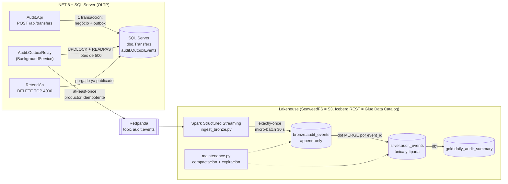

# Lakehouse Audit PoC

Arquitectura de **retención y ciclo de vida de datos de auditoría**. Saca los eventos de auditoría de un core transaccional **.NET 8 + SQL Server** y los lleva a un **Lakehouse** (Apache Spark + Apache Iceberg + dbt, con un catálogo compatible con AWS Glue). Todo corre dockerizado en local.

**Problema.** Las tablas de auditoría crecen sin control dentro de SQL Server, degradan el rendimiento relacional y encarecen la infraestructura.

**Solución.** SQL Server solo guarda una ventana corta (minutos u horas) de eventos en una tabla *outbox*. El histórico completo, inmutable y consultable vive en tablas Iceberg sobre object storage.

---

## Arquitectura



| Capa | Tecnología local | Equivalente en AWS |
|---|---|---|
| Core transaccional | .NET 8 + SQL Server 2022 (contenedor) | ECS/EKS + RDS SQL Server |
| Bus de eventos | Redpanda (API Kafka) | Amazon MSK |
| Object storage | SeaweedFS (API S3) | Amazon S3 |
| Catálogo de tablas | Iceberg REST catalog | **AWS Glue Data Catalog** |
| Procesamiento | Spark 3.5 + Iceberg 1.6 | **AWS Glue 4.0/5.0** (Spark 3.5) |
| Transformación | dbt-spark (modo session) | dbt-glue |
| Mantenimiento | `maintenance.py` | Glue table optimizers o un Glue Job programado |

---

## Cómo levantar el entorno

**Requisitos:** Docker Desktop con WSL 2 y al menos **10 GB de RAM** asignados. El entorno completo ocupa unos 8 GB.

### Opción rápida (Windows)

```powershell
powershell -ExecutionPolicy Bypass -File .\scripts\demo.ps1
```

El script levanta todo, genera tráfico, ejecuta dbt y el mantenimiento, y muestra las consultas de verificación.

### Paso a paso

```bash
# 1. Levantar el flujo continuo: SQL Server, API, relay, Redpanda, SeaweedFS (S3), catálogo e ingesta Spark
docker compose up -d --build

# 2. (Opcional) más tráfico; el servicio load-generator ya envía 100 transferencias cada 10 s
curl -X POST "http://localhost:8081/api/simulate?count=500"
curl http://localhost:8081/api/outbox/stats

# 3. Capas silver y gold, con sus tests de calidad
docker compose run --rm dbt build

# 4. Mantenimiento Iceberg: muestra archivos y tamaño promedio ANTES y DESPUÉS de compactar
docker compose run --rm spark-maintenance

# 5. Verificación de punta a punta
docker compose run --rm spark-sql -f /opt/jobs/verify.sql
```

| Servicio | URL / puerto | Credenciales |
|---|---|---|
| API de negocio | http://localhost:8081 | – |
| SQL Server | `localhost,1433` | `sa` / `Poc_Audit#2026` |
| Redpanda (Kafka) | `localhost:19092` | – |
| S3 (SeaweedFS) | http://localhost:8333 | `admin` / `password` |
| Explorador de archivos S3 | http://localhost:8888/buckets/warehouse/ | – |
| Catálogo Iceberg REST | http://localhost:8181 | – |
| Spark UI (ingesta) | http://localhost:4040 | – |

Para apagar: `docker compose down`. Para borrar también los datos: `docker compose down -v`.

---

## A. Delimitación y offloading (.NET 8)

### Decisión: Transactional Outbox + relay asíncrono

Se compararon tres estrategias:

| Estrategia | Bloqueo transaccional | Pérdida de eventos | Acoplamiento | Veredicto |
|---|---|---|---|---|
| **Buffer asíncrono en memoria** (`Channel<T>`) | Ninguno | **Sí**: si el proceso cae, se pierde lo que estaba en memoria | Bajo | ❌ No cumple "sin pérdida de eventos" |
| **CDC** (SQL Server CDC + Debezium) | Ninguno en la request; el log reader agrega carga de I/O | No | **Alto**: el contrato es el esquema físico de las tablas. Además requiere SQL Agent y Kafka Connect | ⚠️ Válido para sistemas legados que no se pueden tocar |
| **Transactional Outbox** | Mínimo: un INSERT extra en la misma transacción | **No**: el evento existe si y solo si el negocio hizo commit | Bajo: el contrato es un **evento de dominio versionado** | ✅ **Elegido** |

**Por qué Outbox:**
- Es el único camino que garantiza atomicidad entre "pasó el hecho de negocio" y "existe su evento de auditoría" sin transacciones distribuidas.
- La request nunca habla con Kafka ni con el Lakehouse. Si el bus está caído, el negocio sigue operando y el outbox absorbe la diferencia.
- El evento lleva `schema_version`, así que el contrato evoluciona sin depender del modelo relacional interno.

### Cómo se evita el bloqueo

- **`READ_COMMITTED_SNAPSHOT ON`**: lectores y escritores del core no se bloquean entre sí.
- El relay lee con **`UPDLOCK, READPAST, ROWLOCK`**. Varias réplicas pueden trabajar en paralelo sin tomar las mismas filas, y los INSERT de la API nunca esperan al relay.
- **Índices filtrados**: `WHERE PublishedAt IS NULL` para buscar pendientes y `WHERE PublishedAt IS NOT NULL` para la purga. Así el relay no escanea el histórico.
- **Purga por lotes** (`DELETE TOP (4000)` en bucle). Las transacciones son cortas, quedan por debajo del umbral de escalamiento de bloqueos (unas 5000 filas) y el log de transacciones no crece de golpe. Solo se borran filas ya publicadas y más viejas que la ventana de retención (10 minutos en la demo; días en producción).

### Cómo se evita la pérdida de eventos

- **Productor idempotente** (`EnableIdempotence`, `acks=all`). Las filas se marcan como publicadas solo después del ack de Kafka.
- Garantía de **entrega at-least-once**. Si algo falla entre el ack y el UPDATE, el lote se reenvía. Los duplicados se eliminan en silver con un `MERGE` por `event_id`, así que el resultado neto es *effectively-once*.
- Clave de partición `aggregate_id`: orden garantizado por entidad.

Código: [`src/Audit.Api/Domain/TransferService.cs`](src/Audit.Api/Domain/TransferService.cs), [`src/Audit.OutboxRelay/OutboxRelayService.cs`](src/Audit.OutboxRelay/OutboxRelayService.cs), [`src/Audit.OutboxRelay/OutboxRetentionService.cs`](src/Audit.OutboxRelay/OutboxRetentionService.cs).

---

## B. Diseño del Data Lakehouse

### Modelo por capas

| Tabla | Contenido | Escritura | Propósito |
|---|---|---|---|
| `bronze.audit_events` | Eventos tal como llegaron (payload JSON crudo, offsets de Kafka, mensajes malformados en `raw_value`) | Spark Streaming, **append-only** | Evidencia inmutable, base para re-procesar |
| `silver.audit_events` | Un registro por `event_id`, tipado, con el payload interpretado según `schema_version` | dbt incremental `MERGE` | Consumo analítico y regulatorio |
| `gold.daily_audit_summary` | Agregado diario por tipo, canal y moneda | dbt `table` | Tableros y reportes |

### Particionamiento

- **`days(occurred_at)`** con *hidden partitioning* de Iceberg. Las consultas filtran por fecha del hecho de negocio (`WHERE occurred_at BETWEEN ...`) y Iceberg poda particiones sin que el usuario conozca la columna física. La granularidad se puede cambiar después (por ejemplo a `months`) con *partition evolution*, sin reescribir datos.
- **No** se particiona por cuenta ni por tipo de evento, porque son columnas de alta cardinalidad y generan miles de particiones diminutas. Para filtrar por cuenta, lo indicado en producción es ordenar los archivos (`sort` o `zorder` en la compactación), no particionar.
- Se particiona por `occurred_at` y no por `ingested_at`: la retención regulatoria y las consultas se razonan en tiempo de negocio.

### Compactación: el problema de los archivos pequeños

El streaming escribe al menos un archivo por partición en cada micro-batch (cada 30 s), lo que da miles de archivos de pocos KB al día. Eso degrada la planificación y la lectura. Se ataca en dos frentes:

- **Prevención:** `write.distribution-mode=hash` (un escritor por partición), `write.target-file-size-bytes=128MB` y micro-batches de 30 s en lugar de 1 s.
- **Corrección:** [`spark/jobs/maintenance.py`](spark/jobs/maintenance.py) ejecuta `rewrite_data_files` (binpack), `rewrite_manifests`, `expire_snapshots` y `remove_orphan_files`. Imprime la cantidad de archivos y el tamaño promedio antes y después para evidenciar el efecto.
- **En AWS:** los *table optimizers* del Glue Data Catalog (compactación, retención de snapshots y borrado de huérfanos administrados) o este mismo script como Glue Job programado.

### ACID en tablas de auditoría

- Cada micro-batch y cada `MERGE` es un **commit atómico de snapshot**. Los lectores nunca ven escrituras a medias (aislamiento por snapshot).
- **Concurrencia optimista:** la compactación corre mientras el streaming sigue escribiendo, porque un *append* no choca con un *rewrite* de archivos existentes.
- **Inmutabilidad:** bronze es append-only. El historial de snapshots (`bronze.audit_events.snapshots`) es en sí mismo una pista de auditoría de qué se escribió y cuándo, con *time travel* durante la ventana de retención.
- **Borrados regulatorios** (derecho al olvido o fin de retención legal): `DELETE`/`MERGE` con **copy-on-write**. Son raros, y COW mantiene la lectura rápida sin acumular *delete files*. Luego `expire_snapshots` elimina físicamente los datos borrados.
- **Exactly-once en la ingesta:** offsets de Kafka en el checkpoint de Spark más un commit atómico en Iceberg.

### Evolución de esquemas

- **En el contrato:** cada evento lleva `schema_version`. La demo emite v1 (sin canal) y v2 (con `channel`) al mismo tiempo.
- **En bronze:** el payload se guarda como JSON crudo, así que ningún cambio en el origen rompe la ingesta.
- **En silver:** se interpreta por versión (`case when schema_version >= 2 ...`). dbt usa `on_schema_change='append_new_columns'`, e Iceberg rastrea columnas **por id y no por nombre o posición**, por lo que agregar, renombrar o ampliar columnas no reescribe datos.
- **Regla de compatibilidad:** solo cambios aditivos dentro de una versión. Un cambio incompatible implica una nueva versión del evento.

### Retención y ciclo de vida completo

| Dónde | Cuánto | Mecanismo |
|---|---|---|
| SQL Server (outbox) | Minutos u horas | `OutboxRetentionService` (purga por lotes de lo publicado) |
| Redpanda/Kafka | 7 días | `retention.ms` del topic (ventana de re-proceso) |
| Iceberg bronze/silver | Años (según la regulación) | Snapshots expirados semanalmente; borrado lógico por `DELETE` + expiración |
| Archivos fríos | > 1 año | S3 Lifecycle hacia Glacier Instant Retrieval (Iceberg sigue leyendo) |

---

## C. Uso orquestado de IA

Ver [`docs/ai-usage.md`](docs/ai-usage.md): prompts clave, en qué se aceleró el trabajo y las **correcciones y decisiones humanas** donde la IA dio respuestas genéricas o erróneas.

---

## D. Prueba de concepto dockerizada

El `docker-compose.yml` levanta el flujo end-to-end con un presupuesto de memoria para un equipo de 16 GB:

```
load-generator → audit-api → SQL Server (outbox) → outbox-relay → Redpanda → spark-ingest → Iceberg bronze
                                                                         dbt → silver → gold;  spark-maintenance
```

Cómo validar que funciona:
1. `GET /api/outbox/stats`: `pending` cerca de 0 (el relay publica) y `outboxRows` acotado (la retención purga).
2. `verify.sql`:
   - bronze muestra los eventos crudos
   - silver muestra los mismos eventos sin duplicados
   - conviven `schema_version` 1 y 2
   - gold está poblado
   - el historial de snapshots muestra los commits del streaming y de la compactación
3. `spark-maintenance`: el número de archivos de bronze baja tras la compactación.
4. Explorador de SeaweedFS (http://localhost:8888/buckets/warehouse/): carpetas `data/` (Parquet) y `metadata/` (JSON y Avro de Iceberg) de cada tabla.

### Resultados de una ejecución real (Windows, 16 GB de RAM)

Salida de `scripts/demo.ps1` el 25/11/2026:

| Verificación | Resultado |
|---|---|
| Eventos en bronze | 1 900 |
| Duplicados por `event_id` en bronze | 0 |
| Eventos únicos en silver (en ese momento) | 1 300 |
| Evolución de esquema en silver | v1 `NOT_CAPTURED`: 489 · v2 `API` 215, `BRANCH` 167, `MOBILE` 203, `WEB` 226 |
| Gold | 10 filas (fecha × canal × moneda) |
| Snapshots de bronze | `append` cada 30 s (streaming) más 2 `replace` (compactación) |
| Compactación de silver | 1 archivo de 73 KB, 1 snapshot tras expirar |

**Cómo leer estos números:**
- **Silver tiene menos eventos que bronze, y es lo esperado.** dbt es incremental y por lotes: procesó lo que había en bronze cuando se ejecutó, mientras el streaming siguió agregando micro-batches. Al volver a ejecutar `docker compose run --rm dbt build`, silver se pone al día. Esa latencia es la frontera entre la ingesta continua y la transformación programada.
- **La compactación convive con el streaming.** Los snapshots `replace` aparecen intercalados con los `append`, sin conflictos. Es la concurrencia optimista de Iceberg funcionando.

### Decisiones de la PoC y sus límites

- **Glue Data Catalog no tiene emulador local oficial.** Se usa el catálogo Iceberg REST, y en AWS solo cambia la configuración del catálogo en [`spark/conf/spark-defaults.conf`](spark/conf/spark-defaults.conf) (`catalog-impl=GlueCatalog`). Los jobs y los modelos dbt no cambian.
- **SeaweedFS en lugar de MinIO.** MinIO retiró sus imágenes públicas de Docker Hub y de quay.io en 2026. SeaweedFS ofrece la misma API S3 (Apache 2.0), y el bucket se crea con la `aws-cli` oficial, así que el código no depende del proveedor: en AWS es S3 directamente.
- **Imagen Spark propia** (Spark 3.5.3 + Iceberg 1.6.1, la misma línea que Glue 4.0/5.0) en lugar de imágenes de terceros, para tener control de versiones.
- **dbt en modo `session`:** evita mantener un Thrift Server levantado y ahorra unos 2 GB de RAM. En AWS se usaría `dbt-glue`.
- **`remove_orphan_files` se omite en local.** En Iceberg 1.6 este procedimiento lista archivos con el FileSystem de Hadoop, que no reconoce `s3://` sin el conector `hadoop-aws` (unos 280 MB de jars). Se dejó fuera para mantener la imagen liviana, y el job lo registra sin detener el resto del mantenimiento. En AWS lo cubre el optimizador de archivos huérfanos del Glue Data Catalog.
- **Fuera del alcance de la PoC:** autenticación, TLS, secretos (se usan valores por defecto locales), alta disponibilidad, orquestación con Airflow o Step Functions, y migraciones versionadas (`DatabaseInitializer` es idempotente pero simple).

---

## Estructura del repositorio

```
├── docker-compose.yml
├── LakehouseAudit.sln
├── src/
│   ├── Audit.Api/              # API .NET 8: negocio + outbox en una transacción
│   └── Audit.OutboxRelay/      # Worker .NET 8: relay a Kafka + retención en SQL Server
├── spark/
│   ├── Dockerfile              # Spark 3.5.3 + Iceberg 1.6.1 + Kafka + dbt
│   ├── conf/spark-defaults.conf
│   └── jobs/                   # ingest_bronze.py, maintenance.py, verify.sql
├── dbt/                        # modelos silver/gold + tests
├── scripts/demo.ps1            # demo end-to-end en Windows
└── docs/ai-usage.md            # sección C
```

---

## Respuestas a las preguntas estructurales (sección 03)

### 1. Impacto relacional vs. analytics

**¿Por qué mantener logs en SQL Server es un anti-patrón a escala?**

SQL Server está optimizado para OLTP: muchas escrituras y lecturas pequeñas, por fila, con bloqueos y log transaccional. Un log de auditoría tiene el perfil opuesto: escribe una vez, casi nunca se actualiza, crece sin límite y se consulta en barridos analíticos ("todas las transferencias de la cuenta X en 2025"). Cuando ambos perfiles conviven en la misma base:

- **Compiten por los mismos recursos.** Cada página de auditoría que entra al *buffer pool* desplaza páginas calientes del negocio. Cada INSERT de auditoría escribe en el mismo log transaccional que las transacciones críticas. Las consultas de auditoría (barridos grandes) generan I/O y bloqueos que afectan la latencia del core.
- **El mantenimiento crece con el volumen y no con el valor.** Reconstrucción de índices, `DBCC CHECKDB`, backups y restauraciones tardan más por datos que nadie consulta en línea. El RTO del core empeora por culpa de la auditoría.
- **Borrar es caro y riesgoso.** Purgar millones de filas genera log, escalamiento de bloqueos y fragmentación. Por eso estas tablas suelen crecer para siempre.
- **El almacenamiento más caro guarda los datos más fríos.** Almacenamiento en bloque provisionado, multiplicado por réplicas (Multi-AZ o Always On), más backups y más la licencia por núcleo, que se dimensiona según la carga total.

**Métrica de costo-beneficio propuesta**

No hay un único número. Propongo evaluar tres dimensiones, medidas antes y después del offloading:

| Dimensión | Métrica | Antes (SQL Server) | Después (Iceberg) |
|---|---|---|---|
| **Costo de retención** | USD por GB-mes retenido × copias | Almacenamiento de base de datos × réplicas + backups | Object storage, una copia (la durabilidad la da S3), Parquet comprimido |
| **Impacto en el core** | p95 de latencia de escritura, tamaño del log, ventana de backup/`CHECKDB` | Crece con el histórico | Acotado: el outbox solo guarda la ventana de retención (minutos u horas) |
| **Costo de consulta analítica** | USD y segundos por consulta de auditoría típica | Compite con el OLTP | Cómputo bajo demanda (Athena/Glue/EMR) con poda de particiones y columnas |

**Orden de magnitud** (ilustrativo; se valida con la calculadora de AWS para el caso real):

- S3 Standard cuesta **USD 0.023 por GB-mes** en us-east-1 ([precios S3](https://aws.amazon.com/s3/pricing/)). El almacenamiento de RDS ronda **USD 0.115 por GB-mes** (gp2, ejemplo oficial de [RDS Custom](https://aws.amazon.com/rds/custom/pricing/)), unas **5 veces más por GB**. Y eso antes de multiplicar por réplicas, backups e IOPS.
- A eso se suma la compresión columnar. **Medido en esta PoC:** 1 300 eventos de silver ocupan 73 KB en Parquet+zstd, **unos 57 bytes por evento**, incluyendo una copia del JSON crudo. La misma fila en SQL Server (columnas, `NVARCHAR(MAX)` en UTF-16 e índices) ocupa varias veces más.
- Con lifecycle a Glacier para datos de más de un año, el costo marginal de retener un año más de auditoría tiende a cero.

**Regla de decisión:** el offloading se justifica cuando *(costo mensual de retención en SQL Server + costo de la degradación del core)* > *(costo de S3 + costo de cómputo de ingesta y mantenimiento + costo operativo del pipeline)*. Con volúmenes de auditoría que crecen sin límite, el lado izquierdo crece linealmente y el derecho casi no, así que el punto de equilibrio llega pronto. El beneficio no financiero, y el más importante, es que **el core deja de degradarse con el tiempo**.

### 2. Criterio de herramientas: PySpark vs. dbt, y el papel de Glue/Catalog

| Herramienta | Responsabilidad exacta | Por qué ella y no la otra |
|---|---|---|
| **PySpark** | **Mover y operar datos:** ingesta streaming Kafka → bronze (`ingest_bronze.py`), con checkpoints y exactly-once hacia Iceberg. También el **mantenimiento físico** de las tablas (`maintenance.py`: compactación, manifests, expiración de snapshots). | Son tareas imperativas, con estado (offsets, checkpoints), de larga duración y cercanas al almacenamiento. dbt no hace streaming ni opera archivos. |
| **dbt** | **Lógica de negocio declarativa** sobre datos ya aterrizados: bronze → silver (deduplicación con `MERGE`, tipado, interpretación por `schema_version`) → gold (agregados). También **tests de calidad** (`unique`, `not_null`, `accepted_values`), linaje y documentación. | Son transformaciones SQL versionadas en Git, revisables en un PR y testeables. Cualquier analista puede auditarlas, y no quedan escondidas en código Python. |

**Frontera clara:** PySpark nunca contiene reglas de negocio (bronze es una copia fiel), y dbt nunca toca Kafka ni archivos. Si mañana cambia el bus (Kafka → Kinesis), solo cambia el job de PySpark. Si cambia una regla de negocio, solo cambia un modelo dbt.

**Por qué Glue Data Catalog facilita la gobernanza sin rehacer el modelo:**
- **El modelo no cambia, solo el catálogo.** Las tablas son Iceberg y los jobs las nombran como `lakehouse.bronze.audit_events`. Pasar de local a AWS es cambiar `catalog-impl` a `GlueCatalog` en [`spark-defaults.conf`](spark/conf/spark-defaults.conf). En dbt se cambia el adaptador a `dbt-glue`, y los modelos SQL siguen siendo los mismos.
- **Un solo metastore para todos los motores.** Glue Jobs, Athena, EMR y Redshift Spectrum ven las mismas tablas, esquemas y particiones, sin copias ni ETL entre herramientas.
- **Gobernanza centralizada.** Con Lake Formation sobre el catálogo hay permisos por base, tabla, columna y fila, y etiquetas (LF-Tags) para datos sensibles. Todo se audita en CloudTrail, sin reescribir tablas ni modelos.
- **Mantenimiento administrado.** El Data Catalog ofrece optimizadores de compactación, retención de snapshots y borrado de archivos huérfanos, que se activan por tabla o para todo el catálogo ([AWS Glue: Optimizing Iceberg tables](https://docs.aws.amazon.com/glue/latest/dg/table-optimizers.html)). `maintenance.py` se vuelve opcional en AWS.

### 3. Resiliencia y consistencia: caída de la ingesta durante un pico

La arquitectura tiene **dos amortiguadores durables en serie** y ningún punto que guarde eventos solo en memoria:

```
API ──(misma transacción)──► Outbox (SQL Server) ──► Redpanda/Kafka (7 días) ──► Spark (checkpoint) ──► Iceberg
          amortiguador 1: si Kafka cae      amortiguador 2: si Spark cae      replay desde offsets
```

**Escenario A: cae la ingesta (Spark) durante un pico.**
- La API y el relay no se enteran: siguen escribiendo y publicando. Los eventos se acumulan en el topic, que retiene 7 días (`retention.ms`).
- Al volver, Spark lee el **último offset confirmado en su checkpoint** y procesa el atraso. `maxOffsetsPerTrigger=50000` hace de contrapresión para no saturarse.
- Iceberg confirma cada micro-batch de forma atómica junto con su offset, así que no quedan escrituras parciales ni micro-batches duplicados.

**Escenario B: cae el bus (Kafka) o el relay.**
- La API sigue confirmando transacciones: el evento ya quedó en `audit.OutboxEvents` dentro de la misma transacción del negocio.
- El relay reintenta cada 5 s. Las filas pendientes (`PublishedAt IS NULL`) **nunca se purgan**, porque la retención solo borra lo ya publicado.
- Cuando el bus vuelve, el relay vacía el atraso en lotes de 500.

**Garantía de cero pérdida:** un evento solo deja de existir en una capa después de estar confirmado en la siguiente. El outbox se marca como publicado tras el ack de Kafka (`acks=all`, productor idempotente). Kafka retiene 7 días. Spark avanza el offset solo cuando Iceberg confirmó el commit.

**Mecanismo de replay, de más fino a más grueso:**
1. **Automático:** Spark reanuda desde su checkpoint.
2. **Re-proceso desde Kafka:** un checkpoint nuevo con `startingOffsets` en un offset o timestamp dado relee hasta 7 días. Los duplicados que produzca son inocuos, porque silver hace `MERGE` por `event_id`.
3. **Re-proceso desde bronze:** bronze es inmutable y guarda el JSON crudo, así que `dbt build --full-refresh` reconstruye silver y gold desde cero. Con *time travel* de Iceberg se puede leer el estado exacto de una fecha anterior.

**Prueba reproducible en la PoC:**
```powershell
docker compose stop spark-ingest                                    # simula la caída
Invoke-RestMethod -Method Post "http://localhost:8081/api/simulate?count=1000"   # pico de carga
docker compose run --rm spark-sql -e "SELECT count(*) FROM bronze.audit_events"  # no aumenta
docker compose start spark-ingest                                   # se recupera
# ~60 s después: el conteo aumenta en 1000 y no aparecen duplicados en silver tras dbt build
```

**Riesgos que asumo y cómo se cerrarían en producción:**
- Si la ingesta estuviera caída **más tiempo que la retención de Kafka**, se perderían eventos del topic. Mitigación: alarma sobre el *consumer lag* y una retención de Kafka mucho mayor que el tiempo de recuperación esperado.
- En la PoC el outbox se purga a los 10 minutos de publicado, **sin verificar que el evento llegó a bronze**. En producción la purga debería condicionarse a la marca de agua del lakehouse (máximo offset confirmado en bronze), para que el outbox sea también un respaldo de replay.
- La PoC usa un solo broker con replicación 1. En producción: MSK con `replication.factor=3` y `min.insync.replicas=2`.

### 4. Control del output de IA

Ver el detalle completo en [`docs/ai-usage.md`](docs/ai-usage.md). El caso más claro:

**Sugerencia errónea:** la IA armó el entorno con **MinIO** (`minio/minio` y `minio/mc`) como S3 local, la opción "de manual" en casi todos los tutoriales de Iceberg. Lo presentó como algo listo para usar, sin verificar que las imágenes existieran. En la primera ejecución real, `docker compose up` falló con `pull access denied for minio/mc`: MinIO había retirado sus imágenes públicas de Docker Hub y de quay.io en 2026. La IA respondió con conocimiento desactualizado y con la seguridad de quien no tiene dudas.

**Corrección con criterio:**
- **No aceptar "debería funcionar":** la falla apareció porque se ejecutó el entorno de verdad en lugar de dar por bueno un compose que "se veía bien".
- **No parchear con un mirror no oficial** de MinIO (hay varios en Docker Hub), porque sería meter en la cadena de suministro una imagen de un tercero desconocido.
- Se reemplazó por **SeaweedFS** (API S3, Apache 2.0), y el bucket se crea con la **aws-cli oficial**. Así la PoC depende del **protocolo S3** y no de un proveedor.
- **Regla adoptada:** antes de usar cualquier imagen o versión sugerida por la IA, se verifica en el registro real que exista y esté mantenida.

**Otras dos correcciones del mismo tipo:**
- La IA sugirió `wsl --install` como paso estándar, y en este equipo devolvió **403**. Se resolvió activando las características de Windows con `dism` y usando `wsl --update --web-download`.
- La IA incluyó `remove_orphan_files` en el mantenimiento y lo describió como parte de la solución, sin aclarar que en Iceberg 1.6 no funciona con `s3://` sin el conector `hadoop-aws`. Al ejecutarlo falló. Se documentó como un límite consciente en vez de esconderlo.
