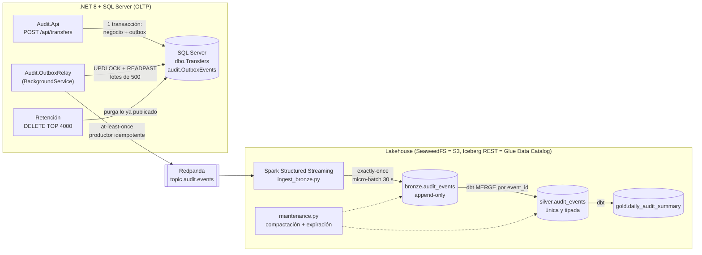

# Lakehouse Audit PoC

Arquitectura de **retención y ciclo de vida de datos de auditoría**: los eventos de auditoría salen de un core **.NET 8 + SQL Server** y se guardan en un **Lakehouse** (Spark + Iceberg + dbt, con catálogo compatible con AWS Glue). Todo corre dockerizado en local.

- **Problema:** las tablas de auditoría crecen sin control en SQL Server, degradan el rendimiento y encarecen la infraestructura.
- **Solución:** SQL Server guarda solo una ventana corta de eventos (tabla *outbox*). El histórico vive en tablas Iceberg sobre object storage, mucho más barato.

---

## Arquitectura



| Capa | Local | En AWS |
|---|---|---|
| Core transaccional | .NET 8 + SQL Server 2022 | ECS/EKS + RDS SQL Server |
| Bus de eventos | Redpanda (API Kafka) | Amazon MSK |
| Object storage | SeaweedFS (API S3) | Amazon S3 |
| Catálogo | Iceberg REST | **AWS Glue Data Catalog** |
| Procesamiento | Spark 3.5 + Iceberg 1.6 | **AWS Glue** (Spark 3.5) |
| Transformación | dbt-spark | dbt-glue |
| Mantenimiento | `maintenance.py` | Glue table optimizers |

---

## Cómo levantarlo

**Requisitos:** Git y Docker Desktop (con WSL 2 en Windows), con al menos 10 GB de RAM asignados a Docker.

**1. Obtener el código:**
```bash
git clone https://github.com/AnaSofiacastillo31/lakehouse-audit-poc.git
cd lakehouse-audit-poc
```

**2a. Opción rápida (Windows, PowerShell):** ejecuta toda la demo de punta a punta.
```powershell
powershell -ExecutionPolicy Bypass -File .\scripts\demo.ps1
```

**2b. Paso a paso (Windows, Linux o Mac):**
```bash
docker compose up -d --build                                 # levanta todo el flujo
# esperar 2-3 minutos: Spark debe crear la tabla bronze y escribir los primeros lotes
docker compose run --rm dbt build                            # crea silver y gold, y corre los tests
docker compose run --rm spark-maintenance                    # compactación
docker compose run --rm spark-sql -f /opt/jobs/verify.sql    # verificación
```

> La primera ejecución descarga unos 4 GB de imágenes y puede tardar varios minutos. Los puertos 1433, 4040, 8081, 8181, 8333, 8888 y 19092 deben estar libres.

| Servicio | Dirección | Credenciales |
|---|---|---|
| API | http://localhost:8081 | – |
| SQL Server | `localhost,1433` | `sa` / `Poc_Audit#2026` |
| Archivos del lakehouse | http://localhost:8888/buckets/warehouse/ | – |
| Spark UI | http://localhost:4040 | – |

Apagar: `docker compose down` (con `-v` borra también los datos).

---

## A. Offloading desde .NET 8

| Opción | ¿Pierde eventos? | Problema | Veredicto |
|---|---|---|---|
| Buffer en memoria | **Sí**, si el proceso cae | Incumple "cero pérdida" | ❌ |
| CDC (Debezium) | No | Se acopla al esquema físico de las tablas | ⚠️ Solo para sistemas que no se pueden tocar |
| **Transactional Outbox** | **No** | Un INSERT extra por operación | ✅ **Elegido** |

**Cómo funciona:** la API guarda la operación y su evento de auditoría **en la misma transacción**. Un worker (relay) los publica en Kafka y después los purga de SQL Server.

- **Sin bloqueo:**
  - RCSI activado, para que lectores y escritores no se esperen.
  - El relay lee con `UPDLOCK, READPAST, ROWLOCK`, así que nunca frena a la API.
  - La purga va en lotes de 4000 filas, por debajo del umbral de escalamiento de bloqueos.
- **Sin pérdida:** el evento solo se marca como publicado después de la confirmación de Kafka. Si algo falla, se reenvía (at-least-once), y el duplicado se elimina en silver por `event_id`.

Código: [`TransferService.cs`](src/Audit.Api/Domain/TransferService.cs) · [`OutboxRelayService.cs`](src/Audit.OutboxRelay/OutboxRelayService.cs) · [`OutboxRetentionService.cs`](src/Audit.OutboxRelay/OutboxRetentionService.cs)

---

## B. Diseño del Lakehouse

| Capa | Contenido | Escribe |
|---|---|---|
| **bronze** | Copia fiel e inmutable de cada evento (JSON crudo) | Spark Streaming, solo append |
| **silver** | Un registro por evento, limpio y tipado | dbt, `MERGE` por `event_id` |
| **gold** | Resumen diario por tipo, canal y moneda | dbt |

| Tema | Decisión | Por qué |
|---|---|---|
| **Particionamiento** | `days(occurred_at)` | Las consultas de auditoría filtran por fecha. Por cuenta saldrían miles de particiones diminutas. |
| **Small files** | Micro-batches de 30 s + compactación (`rewrite_data_files`) | El streaming genera muchos archivos pequeños que hacen lentas las lecturas. |
| **ACID** | Snapshots de Iceberg, tablas append-only, copy-on-write | Nadie lee datos a medio escribir, y la compactación convive con el streaming. |
| **Evolución de esquema** | Cada evento lleva `schema_version`; bronze guarda el JSON crudo | Un cambio en el origen nunca rompe la ingesta; silver interpreta cada versión. |

**Retención:** SQL Server guarda minutos, Kafka 7 días y el lakehouse años (con lifecycle a Glacier).

---

## C. Uso orquestado de IA

Usé **Claude** (Anthropic) como par técnico para analizar el enunciado y generar partes del código (PySpark, dbt y Docker Compose). Mi papel fue dirigir, ejecutar y validar cada paso en mi máquina.

**Prompts clave**

| Prompt (resumido) | Para qué sirvió |
|---|---|
| "Analiza la información y tracemos una línea para empezar a usar outbox y descartar cdc y buffer" | Plan por fases y comparación outbox / CDC / buffer |
| "En la el archivo src, no agregues el apartado de pruebas, ya que no es parte del proyecto" | Frenar a la IA, que especulaba sobre partes del enunciado que no tenía |
| Errores de versiones de imagenes al momento de la descarga | Corregir con evidencia, ya que las imagenes no existian
| Salida completa de la demo | Validar resultados y documentar los límites |

**Dónde la IA se equivocó y cómo se corrigió**

| Error de la IA | Qué pasó | Corrección |
|---|---|---|
| Usó **MinIO** como S3 local sin verificarlo | `pull access denied`: MinIO retiró sus imágenes públicas | Cambio a SeaweedFS (API S3) y verificación de cada imagen en Docker Hub |
| Indicó `wsl --install` como paso estándar | Devolvió 403 en este equipo | Activar las características de Windows con `dism` y usar `wsl --update --web-download` |
| Dio por hecho que las imágenes de Microsoft descargarían bien | Timeout de red contra `mcr.microsoft.com` | Pre-descargar con `docker pull` y usar una imagen base menos |
| Especuló sobre el enunciado | Suponía información que no tenía | Se le pidió trabajar dentro de los parámetros establecidos en el enuncido |

**Decisiones que asumo y defiendo:** outbox en lugar de CDC o buffer, catálogo REST como sustituto local de Glue, particionamiento por día y purga por lotes de menos de 5000 filas.

---

## D. Prueba de concepto

**Resultados de una ejecución real** (Windows, 16 GB de RAM):

| Verificación | Resultado |
|---|---|
| Eventos en bronze | 1 900 |
| Duplicados por `event_id` | 0 |
| Eventos v1 / v2 en silver | 489 / 811 (evolución de esquema) |
| Compactación | Snapshots `replace` intercalados con los `append` del streaming |
| Tamaño en Parquet | ~57 bytes por evento |

En esa ejecución silver tenía menos eventos que bronze (1 300 vs. 1 900). Es lo esperado: dbt procesa por lotes lo que había en ese momento, y se pone al día al volver a ejecutarlo.

**Límites conocidos:**
- **Glue Data Catalog no corre en local:** se usa un catálogo Iceberg REST. En AWS solo cambia `catalog-impl` en [`spark-defaults.conf`](spark/conf/spark-defaults.conf).
- **MinIO retiró sus imágenes públicas:** se usa SeaweedFS, que tiene la misma API S3.
- **`remove_orphan_files` no funciona en local** con Iceberg 1.6 sin `hadoop-aws`. En AWS lo cubre Glue.
- **Fuera del alcance:** seguridad, alta disponibilidad y orquestación.

---

## Estructura

```
├── docker-compose.yml       # levanta todo
├── src/Audit.Api/           # API .NET 8: negocio + outbox
├── src/Audit.OutboxRelay/   # publica a Kafka y purga SQL Server
├── spark/jobs/              # ingesta, mantenimiento y verificación
├── dbt/models/              # silver, gold y tests
└── scripts/demo.ps1         # demo en Windows
```

---

## Respuestas a las preguntas estructurales

### 1. ¿Por qué logs en SQL Server es un anti-patrón y cuál es la métrica costo-beneficio?

SQL Server está hecho para operaciones pequeñas y rápidas. Un log solo crece y se consulta en barridos grandes. Si conviven en la misma base:
- compiten por memoria, disco y log transaccional,
- los backups y el mantenimiento tardan cada vez más,
- y se paga almacenamiento caro por datos fríos.

**Métrica:** comparar antes y después en tres dimensiones.

| Dimensión | Qué medir |
|---|---|
| Costo | USD por GB-mes retenido. S3 cuesta ~USD 0.023, varias veces menos que el disco de una base de datos ([precios S3](https://aws.amazon.com/s3/pricing/)). |
| Impacto en el core | Latencia p95, tamaño del log, ventana de backup |
| Consulta | Costo y tiempo de una consulta de auditoría típica |

En la PoC, Parquet comprimido ocupa ~57 bytes por evento. Y lo más importante: **el core deja de degradarse con el tiempo**.

### 2. ¿Qué hace PySpark y qué hace dbt? ¿Por qué Glue facilita la gobernanza?

| Herramienta | Responsabilidad |
|---|---|
| **PySpark** | **Mover y operar** datos: ingesta streaming desde Kafka y mantenimiento de las tablas. |
| **dbt** | **Reglas de negocio** en SQL versionado: deduplicar, tipar, resumir y probar la calidad. |

**Glue:** el modelo no cambia, solo la configuración del catálogo. Además da:
- un único catálogo para Athena, EMR y Redshift,
- permisos por tabla, columna y fila con Lake Formation,
- compactación y limpieza automáticas ([Glue table optimizers](https://docs.aws.amazon.com/glue/latest/dg/table-optimizers.html)).

### 3. Si la ingesta cae durante un pico, ¿cómo se garantiza cero pérdida y cómo es el replay?

Hay **dos colchones durables** y nada vive solo en memoria:

```
API ──► Outbox (SQL Server) ──► Kafka (7 días) ──► Spark (checkpoint) ──► Iceberg
```

- **Si cae Spark:** los eventos esperan en Kafka. Al volver, Spark retoma desde su último checkpoint.
- **Si cae Kafka:** los eventos esperan en el outbox. La purga nunca borra lo pendiente.

**Replay:**
1. **Automático:** Spark retoma desde su checkpoint.
2. **Desde Kafka:** relee hasta 7 días atrás.
3. **Desde bronze:** `dbt build --full-refresh` reconstruye silver y gold.

Los duplicados que deje cualquier replay se eliminan en silver por `event_id`.

**Para producción falta:** que la purga del outbox espere la confirmación de bronze, y Kafka con 3 réplicas.

**Pruébalo:**
```powershell
docker compose stop spark-ingest
Invoke-RestMethod -Method Post "http://localhost:8081/api/simulate?count=1000"
docker compose start spark-ingest     # en ~60 s bronze se pone al día
```

### 4. Una alucinación de la IA y cómo se corrigió

La IA configuró **MinIO** como S3 local y lo dio por listo. Al ejecutarlo, falló con `pull access denied`: **MinIO había retirado sus imágenes públicas**. La IA respondió con conocimiento desactualizado y sin verificar.

**Corrección:** no usar mirrors no oficiales. Se cambió a **SeaweedFS** (API S3 estándar) y se verificó cada imagen en Docker Hub antes de usarla.

**Regla adoptada:** nada de lo que sugiere la IA cuenta como hecho hasta que corre en la máquina real. Las demás correcciones están en la sección C.
