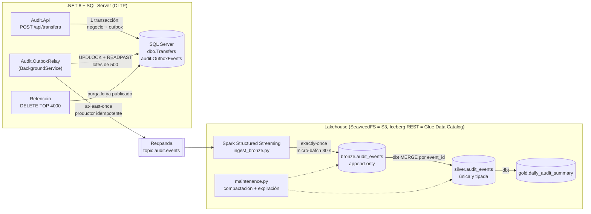

# Lakehouse Audit PoC

Arquitectura de **retención y ciclo de vida de datos de auditoría**. Saca los eventos de auditoría de un core transaccional **.NET 8 + SQL Server** y los lleva a un **Lakehouse** (Apache Spark + Apache Iceberg + dbt, con un catálogo compatible con AWS Glue). Todo corre dockerizado en local.

**Problema.** Las tablas de auditoría crecen sin control dentro de SQL Server, degradan el rendimiento relacional y encarecen la infraestructura.

**Solución.** SQL Server solo guarda una ventana corta (minutos u horas) de eventos en una tabla *outbox*. El histórico completo, inmutable y consultable vive en tablas Iceberg sobre object storage.

---

## Arquitectura



| Capa | Tecnología local | Equivalente en AWS |
|---|---|---|
| Core transaccional | .NET 8 + SQL Server 2022 (contenedor) | ECS/EKS + RDS SQL Server |
| Bus de eventos | Redpanda (API Kafka) | Amazon MSK |
| Object storage | SeaweedFS (API S3) | Amazon S3 |
| Catálogo de tablas | Iceberg REST catalog | **AWS Glue Data Catalog** |
| Procesamiento | Spark 3.5 + Iceberg 1.6 | **AWS Glue 4.0/5.0** (Spark 3.5) |
| Transformación | dbt-spark (modo session) | dbt-glue |
| Mantenimiento | `maintenance.py` | Glue table optimizers o un Glue Job programado |

---

## Cómo levantar el entorno

**Requisitos:** Docker Desktop con WSL 2 y al menos **10 GB de RAM** asignados. El entorno completo ocupa unos 8 GB.

### Opción rápida (Windows)

```powershell
powershell -ExecutionPolicy Bypass -File .\scripts\demo.ps1
```

El script levanta todo, genera tráfico, ejecuta dbt y el mantenimiento, y muestra las consultas de verificación.

### Paso a paso

```bash
# 1. Levantar el flujo continuo: SQL Server, API, relay, Redpanda, SeaweedFS (S3), catálogo e ingesta Spark
docker compose up -d --build

# 2. (Opcional) más tráfico; el servicio load-generator ya envía 100 transferencias cada 10 s
curl -X POST "http://localhost:8081/api/simulate?count=500"
curl http://localhost:8081/api/outbox/stats

# 3. Capas silver y gold, con sus tests de calidad
docker compose run --rm dbt build

# 4. Mantenimiento Iceberg: muestra archivos y tamaño promedio ANTES y DESPUÉS de compactar
docker compose run --rm spark-maintenance

# 5. Verificación de punta a punta
docker compose run --rm spark-sql -f /opt/jobs/verify.sql
```

| Servicio | URL / puerto | Credenciales |
|---|---|---|
| API de negocio | http://localhost:8081 | – |
| SQL Server | `localhost,1433` | `sa` / `Poc_Audit#2026` |
| Redpanda (Kafka) | `localhost:19092` | – |
| S3 (SeaweedFS) | http://localhost:8333 | `admin` / `password` |
| Explorador de archivos S3 | http://localhost:8888/buckets/warehouse/ | – |
| Catálogo Iceberg REST | http://localhost:8181 | – |
| Spark UI (ingesta) | http://localhost:4040 | – |

Para apagar: `docker compose down`. Para borrar también los datos: `docker compose down -v`.

---

## A. Delimitación y offloading (.NET 8)

### Decisión: Transactional Outbox + relay asíncrono

Se compararon tres estrategias:

| Estrategia | Bloqueo transaccional | Pérdida de eventos | Acoplamiento | Veredicto |
|---|---|---|---|---|
| **Buffer asíncrono en memoria** (`Channel<T>`) | Ninguno | **Sí**: si el proceso cae, se pierde lo que estaba en memoria | Bajo | ❌ No cumple "sin pérdida de eventos" |
| **CDC** (SQL Server CDC + Debezium) | Ninguno en la request; el log reader agrega carga de I/O | No | **Alto**: el contrato es el esquema físico de las tablas. Además requiere SQL Agent y Kafka Connect | ⚠️ Válido para sistemas legados que no se pueden tocar |
| **Transactional Outbox** | Mínimo: un INSERT extra en la misma transacción | **No**: el evento existe si y solo si el negocio hizo commit | Bajo: el contrato es un **evento de dominio versionado** | ✅ **Elegido** |

**Por qué Outbox:**
- Es el único camino que garantiza atomicidad entre "pasó el hecho de negocio" y "existe su evento de auditoría" sin transacciones distribuidas.
- La request nunca habla con Kafka ni con el Lakehouse. Si el bus está caído, el negocio sigue operando y el outbox absorbe la diferencia.
- El evento lleva `schema_version`, así que el contrato evoluciona sin depender del modelo relacional interno.

### Cómo se evita el bloqueo

- **`READ_COMMITTED_SNAPSHOT ON`**: lectores y escritores del core no se bloquean entre sí.
- El relay lee con **`UPDLOCK, READPAST, ROWLOCK`**. Varias réplicas pueden trabajar en paralelo sin tomar las mismas filas, y los INSERT de la API nunca esperan al relay.
- **Índices filtrados**: `WHERE PublishedAt IS NULL` para buscar pendientes y `WHERE PublishedAt IS NOT NULL` para la purga. Así el relay no escanea el histórico.
- **Purga por lotes** (`DELETE TOP (4000)` en bucle). Las transacciones son cortas, quedan por debajo del umbral de escalamiento de bloqueos (unas 5000 filas) y el log de transacciones no crece de golpe. Solo se borran filas ya publicadas y más viejas que la ventana de retención (10 minutos en la demo; días en producción).

### Cómo se evita la pérdida de eventos

- **Productor idempotente** (`EnableIdempotence`, `acks=all`). Las filas se marcan como publicadas solo después del ack de Kafka.
- Garantía de **entrega at-least-once**. Si algo falla entre el ack y el UPDATE, el lote se reenvía. Los duplicados se eliminan en silver con un `MERGE` por `event_id`, así que el resultado neto es *effectively-once*.
- Clave de partición `aggregate_id`: orden garantizado por entidad.

Código: [`src/Audit.Api/Domain/TransferService.cs`](src/Audit.Api/Domain/TransferService.cs), [`src/Audit.OutboxRelay/OutboxRelayService.cs`](src/Audit.OutboxRelay/OutboxRelayService.cs), [`src/Audit.OutboxRelay/OutboxRetentionService.cs`](src/Audit.OutboxRelay/OutboxRetentionService.cs).

---

## B. Diseño del Data Lakehouse

### Modelo por capas

| Tabla | Contenido | Escritura | Propósito |
|---|---|---|---|
| `bronze.audit_events` | Eventos tal como llegaron (payload JSON crudo, offsets de Kafka, mensajes malformados en `raw_value`) | Spark Streaming, **append-only** | Evidencia inmutable, base para re-procesar |
| `silver.audit_events` | Un registro por `event_id`, tipado, con el payload interpretado según `schema_version` | dbt incremental `MERGE` | Consumo analítico y regulatorio |
| `gold.daily_audit_summary` | Agregado diario por tipo, canal y moneda | dbt `table` | Tableros y reportes |

### Particionamiento

- **`days(occurred_at)`** con *hidden partitioning* de Iceberg. Las consultas filtran por fecha del hecho de negocio (`WHERE occurred_at BETWEEN ...`) y Iceberg poda particiones sin que el usuario conozca la columna física. La granularidad se puede cambiar después (por ejemplo a `months`) con *partition evolution*, sin reescribir datos.
- **No** se particiona por cuenta ni por tipo de evento, porque son columnas de alta cardinalidad y generan miles de particiones diminutas. Para filtrar por cuenta, lo indicado en producción es ordenar los archivos (`sort` o `zorder` en la compactación), no particionar.
- Se particiona por `occurred_at` y no por `ingested_at`: la retención regulatoria y las consultas se razonan en tiempo de negocio.

### Compactación: el problema de los archivos pequeños

El streaming escribe al menos un archivo por partición en cada micro-batch (cada 30 s), lo que da miles de archivos de pocos KB al día. Eso degrada la planificación y la lectura. Se ataca en dos frentes:

- **Prevención:** `write.distribution-mode=hash` (un escritor por partición), `write.target-file-size-bytes=128MB` y micro-batches de 30 s en lugar de 1 s.
- **Corrección:** [`spark/jobs/maintenance.py`](spark/jobs/maintenance.py) ejecuta `rewrite_data_files` (binpack), `rewrite_manifests`, `expire_snapshots` y `remove_orphan_files`. Imprime la cantidad de archivos y el tamaño promedio antes y después para evidenciar el efecto.
- **En AWS:** los *table optimizers* del Glue Data Catalog (compactación, retención de snapshots y borrado de huérfanos administrados) o este mismo script como Glue Job programado.

### ACID en tablas de auditoría

- Cada micro-batch y cada `MERGE` es un **commit atómico de snapshot**. Los lectores nunca ven escrituras a medias (aislamiento por snapshot).
- **Concurrencia optimista:** la compactación corre mientras el streaming sigue escribiendo, porque un *append* no choca con un *rewrite* de archivos existentes.
- **Inmutabilidad:** bronze es append-only. El historial de snapshots (`bronze.audit_events.snapshots`) es en sí mismo una pista de auditoría de qué se escribió y cuándo, con *time travel* durante la ventana de retención.
- **Borrados regulatorios** (derecho al olvido o fin de retención legal): `DELETE`/`MERGE` con **copy-on-write**. Son raros, y COW mantiene la lectura rápida sin acumular *delete files*. Luego `expire_snapshots` elimina físicamente los datos borrados.
- **Exactly-once en la ingesta:** offsets de Kafka en el checkpoint de Spark más un commit atómico en Iceberg.

### Evolución de esquemas

- **En el contrato:** cada evento lleva `schema_version`. La demo emite v1 (sin canal) y v2 (con `channel`) al mismo tiempo.
- **En bronze:** el payload se guarda como JSON crudo, así que ningún cambio en el origen rompe la ingesta.
- **En silver:** se interpreta por versión (`case when schema_version >= 2 ...`). dbt usa `on_schema_change='append_new_columns'`, e Iceberg rastrea columnas **por id y no por nombre o posición**, por lo que agregar, renombrar o ampliar columnas no reescribe datos.
- **Regla de compatibilidad:** solo cambios aditivos dentro de una versión. Un cambio incompatible implica una nueva versión del evento.

### Retención y ciclo de vida completo

| Dónde | Cuánto | Mecanismo |
|---|---|---|
| SQL Server (outbox) | Minutos u horas | `OutboxRetentionService` (purga por lotes de lo publicado) |
| Redpanda/Kafka | 7 días | `retention.ms` del topic (ventana de re-proceso) |
| Iceberg bronze/silver | Años (según la regulación) | Snapshots expirados semanalmente; borrado lógico por `DELETE` + expiración |
| Archivos fríos | > 1 año | S3 Lifecycle hacia Glacier Instant Retrieval (Iceberg sigue leyendo) |

---

## C. Uso orquestado de IA

Ver [`docs/ai-usage.md`](docs/ai-usage.md): prompts clave, en qué se aceleró el trabajo y las **correcciones y decisiones humanas** donde la IA dio respuestas genéricas o erróneas.

---

## D. Prueba de concepto dockerizada

El `docker-compose.yml` levanta el flujo end-to-end con un presupuesto de memoria para un equipo de 16 GB:

```
load-generator → audit-api → SQL Server (outbox) → outbox-relay → Redpanda → spark-ingest → Iceberg bronze
                                                                         dbt → silver → gold;  spark-maintenance
```

Cómo validar que funciona:
1. `GET /api/outbox/stats`: `pending` cerca de 0 (el relay publica) y `outboxRows` acotado (la retención purga).
2. `verify.sql`:
   - bronze muestra los eventos crudos
   - silver muestra los mismos eventos sin duplicados
   - conviven `schema_version` 1 y 2
   - gold está poblado
   - el historial de snapshots muestra los commits del streaming y de la compactación
3. `spark-maintenance`: el número de archivos de bronze baja tras la compactación.
4. Explorador de SeaweedFS (http://localhost:8888/buckets/warehouse/): carpetas `data/` (Parquet) y `metadata/` (JSON y Avro de Iceberg) de cada tabla.

### Decisiones de la PoC y sus límites

- **Glue Data Catalog no tiene emulador local oficial.** Se usa el catálogo Iceberg REST, y en AWS solo cambia la configuración del catálogo en [`spark/conf/spark-defaults.conf`](spark/conf/spark-defaults.conf) (`catalog-impl=GlueCatalog`). Los jobs y los modelos dbt no cambian.
- **SeaweedFS en lugar de MinIO.** MinIO retiró sus imágenes públicas de Docker Hub y de quay.io en 2026. SeaweedFS ofrece la misma API S3 (Apache 2.0), y el bucket se crea con la `aws-cli` oficial, así que el código no depende del proveedor: en AWS es S3 directamente.
- **Imagen Spark propia** (Spark 3.5.3 + Iceberg 1.6.1, la misma línea que Glue 4.0/5.0) en lugar de imágenes de terceros, para tener control de versiones.
- **dbt en modo `session`:** evita mantener un Thrift Server levantado y ahorra unos 2 GB de RAM. En AWS se usaría `dbt-glue`.
- **Fuera del alcance de la PoC:** autenticación, TLS, secretos (se usan valores por defecto locales), alta disponibilidad, orquestación con Airflow o Step Functions, y migraciones versionadas (`DatabaseInitializer` es idempotente pero simple).

---

## Estructura del repositorio

```
├── docker-compose.yml
├── LakehouseAudit.sln
├── src/
│   ├── Audit.Api/              # API .NET 8: negocio + outbox en una transacción
│   └── Audit.OutboxRelay/      # Worker .NET 8: relay a Kafka + retención en SQL Server
├── spark/
│   ├── Dockerfile              # Spark 3.5.3 + Iceberg 1.6.1 + Kafka + dbt
│   ├── conf/spark-defaults.conf
│   └── jobs/                   # ingest_bronze.py, maintenance.py, verify.sql
├── dbt/                        # modelos silver/gold + tests
├── scripts/demo.ps1            # demo end-to-end en Windows
└── docs/ai-usage.md            # sección C
```

---

## Respuestas a las preguntas de la sección 03

> _Pendiente de completar._
